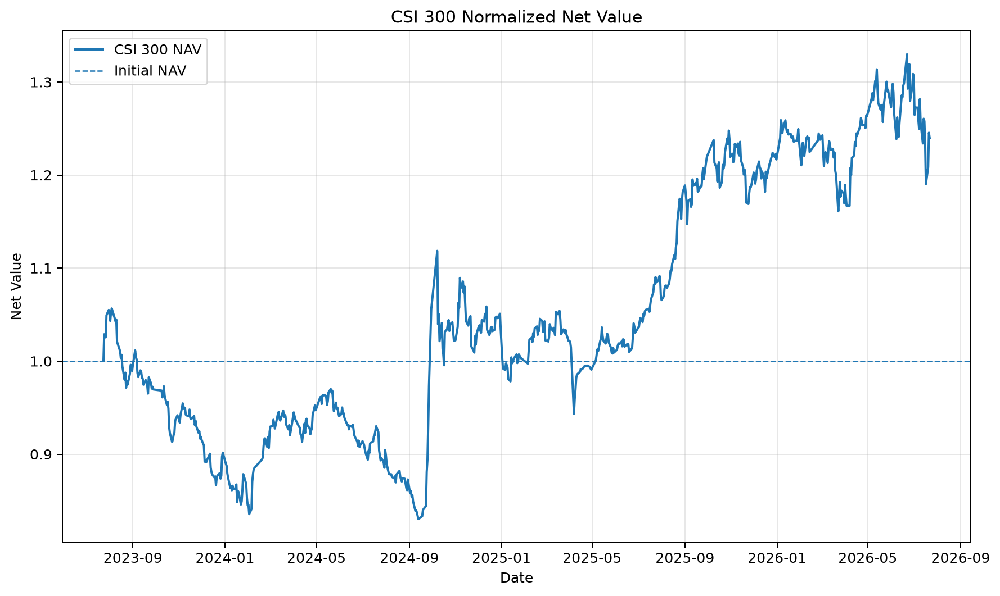

# 沪深300 收益率与风险结构研究

基于沪深300指数（000300）2023-07-24 至 2026-07-22 共 726 个交易日数据，构建收益率计算、净值重构与极值归因分析流程。

## 核心发现

- 三年累计收益 **+23.97%**（期末净值 1.2397），年化约 7.4%
- **2024-09-24 至 10-08 的 9 个交易日累计上涨约 32.5%，超过三年总回报**：长期收益高度集中在极少数交易日
- 最大单日跌幅 −7.05%（2024-10-09）紧随最大涨幅簇，属于同一事件
- 2024-10-08 日收益率 +5.93%，但开盘价即全天最高价，**当日开盘买入者实际亏损 4.37%**：收盘收益率不等于可实现收益
- 简单收益率与对数收益率两条路径构造的净值完全一致（`np.allclose` 交叉验证）



## 方法

**收益率**

- 简单收益率：R_t = P_t / P_{t−1} − 1
- 对数收益率：r_t = ln(1 + R_t)

**净值构造**（两条数学等价路径，互相验证）

- 路径一：NAV_T = Π (1 + R_t)
- 路径二：NAV_T = exp(Σ r_t)

**口径说明**

- 使用价格指数（000300）而非全收益指数（H00300），不含股息再投资，持有收益会被低估约一个市场股息率。
- 收盘价收益率不反映日内路径；极端行情下与可实现收益差异显著，上面的 10-08 案例即为例证。

## 复现

```bash
git clone https://github.com/lpwei-quant/quant-research-2026.git
cd quant-research-2026

python -m venv .venv
.\.venv\Scripts\Activate.ps1      # Windows
source .venv/bin/activate         # Mac/Linux

pip install -r requirements.txt

python fetch_csi300.py            # 获取数据（data/ 未纳入版本控制）
python inspect_csi300.py          # 数据类型、缺失值、重复日期与时间顺序检查
python src/day02_return_analysis.py
python m02_extreme_days.py
```

## 目录结构

```text
quant-research-2026/
├── fetch_csi300.py               # 数据获取
├── inspect_csi300.py             # 数据检查
├── src/day02_return_analysis.py  # 收益率与净值构造
├── m02_extreme_days.py           # 极值归因
├── output/figures/               # 图表输出
└── requirements.txt
```
